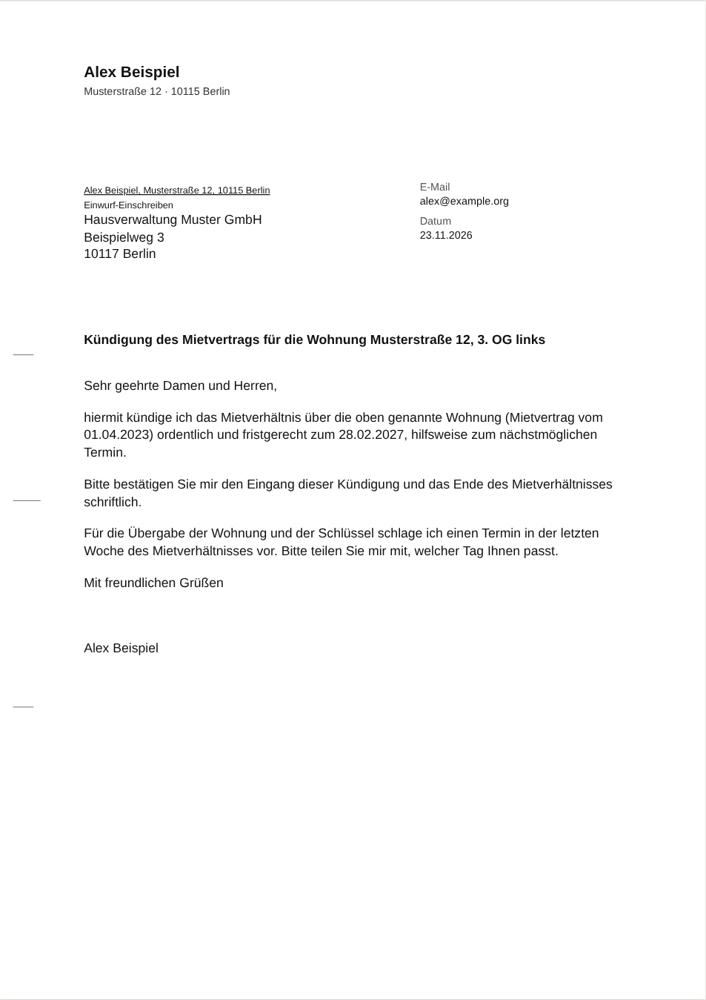

# german-letters

[](https://github.com/Maheen-Joga/german-letters/actions/workflows/tests.yml)

**The formal German letter you need, laid out properly, sent the right way and on time, with every
line explained in English.**

Cancel a flat, a gym or a phone contract, resign from a job, object to a decision from the
Jobcenter or Bezirksamt, ask a company for your data, return an online order. Each of these has a
deadline, a required form (a signed paper original or just an email) and a conventional wording that
officials expect. Getting one of them wrong can cost a month's rent or a lost appeal. This is a Claude
skill and a small command-line tool that gets them right.



Pure Python 3.10+, no dependencies, MIT licensed. **Help with writing, not legal advice.**

## Use it as a Claude skill

```bash
git clone https://github.com/Maheen-Joga/german-letters ~/.claude/skills/german-letters
```

Then tell Claude what happened, in any language: *"My landlord's Hausverwaltung is in Berlin, I want
to move out, how do I cancel?"* or paste the Bescheid you received. Claude asks only for the missing
facts, computes the deadline with your state's public holidays, writes the German letter, explains it
paragraph by paragraph, and gives you a page that prints as one A4 sheet fitting a window envelope.
The instructions it follows are in [SKILL.md](SKILL.md).

## Use it from the command line

```bash
pip install git+https://github.com/Maheen-Joga/german-letters
german-letters list
german-letters deadline objection 20.11.2026 --region BE
german-letters write examples/kuendigung-mietvertrag.json --html brief.html
```

```text
$ german-letters deadline objection 20.11.2026 --region BE
objection must arrive by: Thu 24.12.2026  (§ 70 VwGO / § 84 SGG / § 355 AO with § 41(2) VwVfG / § 37(2) SGB X / § 122(2) AO)
  - counted as delivered on 2026-11-24: the fourth day after the date the authority posted it
  - the objection must arrive by then, not just be posted; if the decision has no or a wrong
    Rechtsbehelfsbelehrung, the period is one year (§ 58 VwGO, § 66 SGG)
```

## The letters

| Template | Letter | Form | Deadline worked out |
|---|---|---|---|
| `kuendigung-mietvertrag` | Tenant cancels a flat | signed paper (§ 568 BGB) | received by the 3rd Werktag, ends with the month after next (§ 573c BGB) |
| `kuendigung-vertrag` | Gym, mobile, internet, streaming, insurance | email is fine (§ 309 No. 13 BGB) | one month after the minimum term (§ 309 No. 9 BGB) |
| `kuendigung-arbeitsvertrag` | Employee resigns | signed paper (§ 623 BGB) | four weeks to the 15th or month end; two weeks in probation (§ 622 BGB) |
| `widerspruch-bescheid` | Objection to a decision by an authority | signed paper | one month after delivery, counted from the fourth day after posting (since 2025) |
| `auskunft-dsgvo` | What data do you hold about me? | email is fine | the company has one month to answer (Art. 12(3) GDPR) |
| `widerruf` | Withdraw from an online purchase | email is fine | 14 days from delivery, sending in time is enough (§ 355 BGB) |

Every template comes with an English explanation of each paragraph, how to send it (Einwurf-Einschreiben,
in person with a witness, email) and the notes people usually learn too late, such as registering as
*arbeitsuchend* within three days of resigning.

## What the tool gets right

- **The 2025 change in delivery rules.** Letters from authorities now count as delivered on the
  fourth day after posting, not the third (Postrechtsmodernisierungsgesetz). Many online guides still say three.
- **Public holidays for all 16 states**, computed from the date of Easter, so a deadline that lands on
  Fronleichnam in Cologne or Reformationstag in Leipzig moves to the next working day (§ 193 BGB).
- **Disputed points give the safe date.** Saturdays count when cancelling a flat (BGH VIII ZR 206/04);
  whether the deadline moves when that day is a Saturday is disputed, so the earlier date is used and
  the note says why.
- **DIN 5008 Form B layout:** address field 45 mm from the top in the envelope window, fold marks at
  105 and 210 mm, punch mark, information block, no "Betreff:" label, lower case after the salutation,
  no comma after the closing. The page is one self-contained HTML file with no external fonts.

## Limits

It covers the six letters above and free-form letters with the same layout. It does not know your
contract: a lease, job contract or collective agreement can set different periods, and the tool says
where to check. Holidays that apply only in some municipalities are left out, which can make a
deadline one day early, never late. For anything with serious consequences, ask a Mieterverein,
Verbraucherzentrale, Sozialberatung or a lawyer.

## Development

```bash
pip install -e ".[dev]"
pytest
```

## License

MIT
